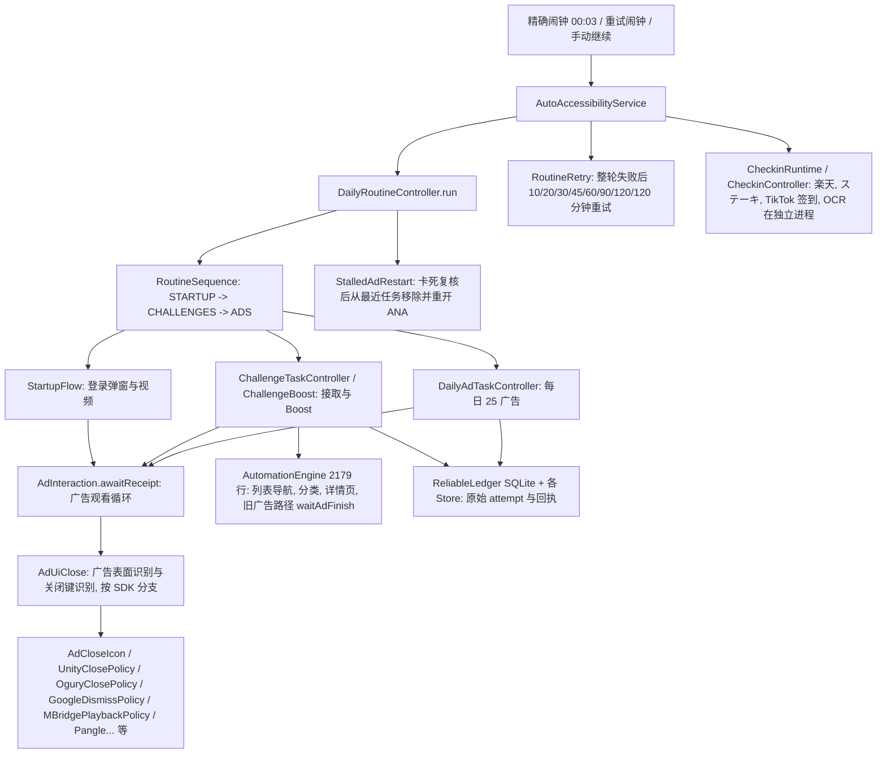

# Tuffy 自动化工程：架构分析委托报告（给 Gemini）

> 撰写日期：2026-11-18（JST）。撰写者：当前负责开发和每日监控的 AI 助手（Claude）。
> 读者：Gemini。**请你对这个工程做一次独立、深入的架构分析，给出改进方案。** 你的分析结果会被交回给我（Claude）来实施，所以请按第 12 节要求的格式输出。
> 本报告里的数字都来自真机日志、源码和 git 历史的统计，不是估算；凡是推测都会写明“推测”。
>
> **你只能访问 GitHub。** 本报告引用的源码与文档全部在公开仓库 `tuffy-xie/tuffy-auto-toolbox` 中，链接都固定在提交 `d3fe80e`（当前真机上运行的版本）。手机日志、故障截图等本地资料不公开，必要内容已经摘录进本报告。
> 如果 blob 链接读不出内容，请改用 raw 形式：`https://raw.githubusercontent.com/tuffy-xie/tuffy-auto-toolbox/d3fe80ed4e2507d507fb87abbf05b63de5ac1bd3/<路径>`。

---

## 0. 一句话说明

一个 **Android 无障碍服务（AccessibilityService）App**，装在一台专用挂机手机上。它每天定时打开几个日本 App，代替人完成每日任务：领签到奖励、接出行挑战、看激励广告领 Boost、看满 25 个每日广告、在其他 App 里签到。**难点不是点按钮，而是第三方广告 SDK 千变万化，而且“结果不确定时绝不重复观看”这条安全规则必须守住。**

---

## 1. 工程是做什么的

### 1.1 业务

| App（包名） | 每天做什么 | 时间（JST） | 优先级 |
|---|---|---|---|
| **ANA Pocket**（`us.ana_pocket.ANAPocket`） | ① 登录奖励弹窗：看一段视频额外拿 100pt ② 出行挑战：按类别（徒步/自行车/汽车/移动不限）筛选距离 ≤ 设定公里数的挑战，**每接一个要看 1 个激励广告**，接完后每个挑战还能 **Boost 5 次，每次 1 个激励广告** ③ 每日广告：官方上限 25 次，每次 1 个激励广告 ④ 月度徽章视频每天 1 次 | 00:03 | P0 |
| 楽天 PointClub | 1 ポイントミッション、ガラガラポン、PICKUP、bonus 抽奖 | 12:00 | P1 |
| いきなり！ステーキ | 每日飞镖 | 12:15 | P1 |
| TikTok Lite | 14 天连续签到、领取昨日奖励、解锁明日奖励、ボーナス報酬每天 1 次 | 12:30 | P1 |

量级：ANA 每天约 **23–24 个挑战 × (1 接取 + 5 Boost) ≈ 140 个激励广告，加上 25 个每日广告，总共约 165 个第三方广告**，全部要自动打开、等待、关闭、确认结果。

### 1.2 运行环境

- 手机：Redmi 12C，Android 14 / HyperOS，常插电、连 Wi‑Fi，专门挂机。业务时区 Asia/Tokyo。
- 一台 Windows 电脑通过 adb 部署和监控（只读日志、导出诊断包、安装 APK）。**运行期间电脑不操作手机**，App 是唯一控制者。
- App：`com.anapocket.auto`，版本 22.0.14-R47 / versionCode 44，minSdk 30，targetSdk 34。
- 构建：JDK 17、Gradle 8.9、AGP 8.5.2、Kotlin 1.9.24。单一 Gradle module（`app`），单一包名 `com.anapocket.auto`（扁平，无分包）。

### 1.3 源码在哪里

| 项 | 位置 |
|---|---|
| 公开仓库 | https://github.com/tuffy-xie/tuffy-auto-toolbox ，默认分支 `feat/h14-ui-memory`（开发分支 `fix/h14-runtime-safety-20261115` 与之同步，都指向 `d3fe80e`） |
| 代码快照（固定版本） | https://github.com/tuffy-xie/tuffy-auto-toolbox/tree/d3fe80ed4e2507d507fb87abbf05b63de5ac1bd3 |
| 主源码 | [app/src/main/java/com/anapocket/auto/](https://github.com/tuffy-xie/tuffy-auto-toolbox/tree/d3fe80ed4e2507d507fb87abbf05b63de5ac1bd3/app/src/main/java/com/anapocket/auto)（119 个 .kt，约 14,500 行，单行很长、很密） |
| 单元测试 | [app/src/test/](https://github.com/tuffy-xie/tuffy-auto-toolbox/tree/d3fe80ed4e2507d507fb87abbf05b63de5ac1bd3/app/src/test)（110 个文件，**838 项 JUnit 全部通过**），含真实截图/节点夹具 `app/src/test/resources/` |
| 最新提交 | `d3fe80e`（2026-11-18） |
| 用户说明 / 开发者说明 | [README.md](https://github.com/tuffy-xie/tuffy-auto-toolbox/blob/d3fe80ed4e2507d507fb87abbf05b63de5ac1bd3/README.md)、[docs/DEVELOPER_NOTES.md](https://github.com/tuffy-xie/tuffy-auto-toolbox/blob/d3fe80ed4e2507d507fb87abbf05b63de5ac1bd3/docs/DEVELOPER_NOTES.md)（后者部分内容停留在 11/01，以本报告为准） |
| 历史报告 | 仓库根目录 `CHANGELOG.md`、`BUG_BACKLOG.md`、`DEVELOPMENT_STATE.md`、`R36…R47_*`、`H13_*`、`H14_*` |

> 第 4.5 节列出了需要优先阅读的源码文件及链接。

---

## 2. 不可违反的约束（任何方案都必须遵守）

这些是项目所有者定下的硬规则，**方案里如果需要突破某条，必须单独标明，并说明理由**：

1. **UNKNOWN / UNCONFIRMED 绝不重播。** 一次广告观看如果没拿到可信回执，就记为未知，保留原始 `runId / index / startedAt`。剩余次数不等于允许重看。只有官方页面明确证明“原操作未生效”，才能转成 FAILED，然后才能开新的一次。
2. **不伪造结果**：不能把推测写成 GAIN / NO_GAIN，不能跨业务日混记。
3. **不 root，不读其他 App 的数据，不改 SQLite 账本，不卸载、不清数据**（卸载会丢账本）。只能用同签名覆盖安装。
4. **不输入任何账号密码**；遇到验证码或账号风险提示立即停下，等人处理。
5. **不点**：安装、Shop Now、商店、购买类按钮。TikTok 只允许点 チェックイン / 獲得する / アンロック，以及 ボーナス報酬 的 受け取る（每天 1 次）。
6. **不盲点坐标**：只点可见、可用、有语义的控件，或经过视觉校验的控件。“计时器到了”不等于出现了关闭键。
7. **不使用 `uiautomator dump`**：实测会破坏无障碍服务。
8. **versionCode 不得自行改成 45**（用户约束）。不合并到 `main`。
9. 签名私钥、Token、日志、账本永不上传。
10. 发版规则：同一个 APK 在真机上**连续 7 个业务日**自然运行无回归，才能发 GitHub Release；中途换包，计数从头算。这意味着**每次改动都有很高的验证成本**，方案要尽量合并成少数几次发布。

---

## 3. 当前架构

### 3.1 调用链



### 3.2 主要文件（行数为物理行，单行很长）

| 文件 | 行数 | 职责 |
|---|---:|---|
| `AutomationEngine.kt` | 2179 | 最早的单体引擎。现在仍承担挑战列表导航、分类筛选、详情页识别；内部还保留旧广告路径 `waitAdFinish()` 和不可达的旧执行链 `execute → runAds`（11/15 审查已确认不可达，未删） |
| `ChallengeBoost.kt` | 1276 | 挑战接取与 Boost、未知结果隔离、官方回执核对 |
| `DailyAdTask.kt` | 748 | 每日 25 广告 |
| `Ui.kt` | 695 | 无障碍操作原语（点击、滑动、返回、截图），含停止闸门 |
| `CheckinController.kt` / `CheckinRuntime.kt` / `CheckinVision.kt` | 637 / 429 / 148 | 三个签到 App，OCR 识别 |
| `AdUiClose.kt` | 455 | 判断“当前是不是广告”，以及“关闭键在哪”，按 SDK 分支 |
| `AdInteraction.kt` | 220 | 新的广告观看状态循环（见 4.1） |
| `StalledAdRestart.kt` + `StalledAdRestartPolicy.kt` | 220 + | 卡死复核与重开 ANA |
| `DailyRoutine.kt` | 152 | 当日编排，含运行内最多 3 次自救 |
| `RoutineRetry.kt` | 103 | 整轮失败后的重试调度 |
| `ReliableLedger.kt` | 122 | SQLite 账本，单表 `records(area, scope, identity, ordinal, payload JSON)` |
| 其余 | — | **46 个 `*Policy` 文件**，每个都是一条纯函数规则，大多对应某次真机事故 |

### 3.3 已有的好设计（请保留）

- **账本是事实来源**：每次接取、每次 Boost、每次每日广告都有独立记录，保存原始身份，不允许用新记录覆盖旧记录。
- **UiOwnership**：带租约的互斥锁，ANA（P0）优先于签到（P1）。
- **端口化**：`AdInteractionPort` 等接口使广告循环可以在 JVM 上回放测试。
- **故障留证**：`FaultStore` 每次异常保存截图、节点、日志，按天限额（200 目录 / 256 MiB）。
- **卡死复核**：重启前要求“画面或节点树 30 秒无变化”的证据，不是只看超时。
- **停止语义**：11/15 已修，取消、停止、重试的含义一致。

---

## 4. 关键代码片段

### 4.1 广告观看循环 `AdInteraction.awaitReceipt`（节选）

结果只在这个循环里判定：离开 ANA → 广告播放 → 回到 ANA 且看到回执弹窗 / 官方计数 +1。

```kotlin
while (port.now() - start < 300_000L) {
    val f = port.frame()
    if (!f.blocked && !f.error && leftEntry && f.anaForeground && f.receipt && !reward) {
        port.receiptObserved(f,before); reward = true; emit(AdState.REWARD_CONFIRMED); port.dismissReceipt() }
    ...
    val segmentBudget = if (nativePangleWait && observedPart == null) 300_000L else 95_000L
    if (port.now() - partStartedAt >= segmentBudget && ...) {
        val key = if (...) port.stallProgressKey() else null      // 画面/节点树指纹
        if (key != null) { ... if (quiet >= STALL_QUIET_MS /*30s*/) { port.stallReviewed(quiet,key)
                 return AdReceipt(AdState.UNCONFIRMED, reward=reward, reason="ad_timeout_95s") } }
        else return AdReceipt(AdState.UNCONFIRMED, ..., reason="ad_timeout_95s")
    }
    if (leftEntry && f.anaForeground && f.entry) {               // 回到 ANA
        if (f.watched == before + 1) { ... return REWARD_CONFIRMED or UNCONFIRMED("reward_receipt_missing") }
        if (f.watched > before + 1) return AdReceipt(UNCONFIRMED, reason="counter_jump_ambiguous")
    }
    // A timer never creates a close button. Only a visible enabled labelled node can be tapped.
    if (... f.closeAvailable && closeBudget && ...) port.close()
}
```

**关键点**：`f.closeAvailable` 来自 `AdUiClose.identifyClose()`，而它是**按 SDK 逐个写的识别规则**（Google、Five、AppLovin、Fyber、Pangle、Ogury、Mintegral、Unity，各有特例）。认不出时，循环就一直等到 95 秒 / 300 秒超时。

### 4.2 当日编排 `DailyRoutineController.run`（节选）

```kotlin
var outcome = RoutineSequence(port).run(); var restarts = 0
while (outcome.state == "BLOCKED" && !stopRequested && restarts < 3) {
    val stage = outcome.steps.entries.firstOrNull{ it.value.state == "BLOCKED" }?.key ...
    if (!StalledAdRestart.recoverBlankDaily(...) && !StalledAdRestart.recover(svc,date,run,stage)) break
    restarts++
    outcome = RoutineSequence(port).run()        // 从头再走 STARTUP -> CHALLENGES -> ADS
}
```

挑战步骤里只要 `!result.continueRun`（例如某个挑战的接取/Boost 结果未知），整个 CHALLENGES 步就返回 BLOCKED。每日广告能否在“出行受阻”后继续，由 `RoutinePolicy.adsAfterBlockedTravel(...)` 个案判断。

### 4.3 整轮重试 `RoutineRetryPolicy`

```kotlin
val delaysMinutes = listOf(10,20,30,45,60,90,120,120)
const val STALL_LIMIT = 2   // 连续 2 次重试“进度指纹”不变就放弃
fun nextDelay(...): Int? { ... if (attempts >= delaysMinutes.size || stalls >= STALL_LIMIT) return null ... }
```

重试的延迟和失败原因无关。

### 4.4 失败原因是散落的字符串

例如 `"ad_timeout_95s"` 一个原因，出现在 **11 个文件**里（AdInteraction、DailyAdTask、ChallengeBoost、ChallengeRecoveryPolicy、StalledAdRestartPolicy、OfficialAdRecoveryPolicy、OfficialLoadFailurePolicy、NativeChallengeReceiptPolicy、FaultScreenshotPolicy、TelegramPolicy……），每处都有自己的 `setOf("ad_timeout_95s","ad_part_timeout_95s",...)` 白名单。全仓约 **97 处**这样的原因清单，约 **50 处**带日期的事故注释（如 `// 11/16 #5: ...`）。新增一种原因时，很容易漏改某个白名单，默认结果就是 BLOCKED。

### 4.5 优先阅读的源码（按重要性排序）

前缀都是 `https://github.com/tuffy-xie/tuffy-auto-toolbox/blob/d3fe80ed4e2507d507fb87abbf05b63de5ac1bd3/app/src/main/java/com/anapocket/auto/`：

| 顺序 | 文件 | 为什么要看 |
|---:|---|---|
| 1 | [AdInteraction.kt](https://github.com/tuffy-xie/tuffy-auto-toolbox/blob/d3fe80ed4e2507d507fb87abbf05b63de5ac1bd3/app/src/main/java/com/anapocket/auto/AdInteraction.kt) | 广告观看循环与结果判定 |
| 2 | [AdUiClose.kt](https://github.com/tuffy-xie/tuffy-auto-toolbox/blob/d3fe80ed4e2507d507fb87abbf05b63de5ac1bd3/app/src/main/java/com/anapocket/auto/AdUiClose.kt) | 广告表面识别、各 SDK 关闭键识别 |
| 3 | [AdCloseIcon.kt](https://github.com/tuffy-xie/tuffy-auto-toolbox/blob/d3fe80ed4e2507d507fb87abbf05b63de5ac1bd3/app/src/main/java/com/anapocket/auto/AdCloseIcon.kt) | 视觉白色 × 检测 |
| 4 | [DailyRoutine.kt](https://github.com/tuffy-xie/tuffy-auto-toolbox/blob/d3fe80ed4e2507d507fb87abbf05b63de5ac1bd3/app/src/main/java/com/anapocket/auto/DailyRoutine.kt) | 当日编排、运行内自救 |
| 5 | [RoutineSequence.kt](https://github.com/tuffy-xie/tuffy-auto-toolbox/blob/d3fe80ed4e2507d507fb87abbf05b63de5ac1bd3/app/src/main/java/com/anapocket/auto/RoutineSequence.kt) | STARTUP → CHALLENGES → ADS 的步骤顺序 |
| 6 | [RoutineRetry.kt](https://github.com/tuffy-xie/tuffy-auto-toolbox/blob/d3fe80ed4e2507d507fb87abbf05b63de5ac1bd3/app/src/main/java/com/anapocket/auto/RoutineRetry.kt) | 整轮重试调度 |
| 7 | [StalledAdRestart.kt](https://github.com/tuffy-xie/tuffy-auto-toolbox/blob/d3fe80ed4e2507d507fb87abbf05b63de5ac1bd3/app/src/main/java/com/anapocket/auto/StalledAdRestart.kt) / [StalledAdRestartPolicy.kt](https://github.com/tuffy-xie/tuffy-auto-toolbox/blob/d3fe80ed4e2507d507fb87abbf05b63de5ac1bd3/app/src/main/java/com/anapocket/auto/StalledAdRestartPolicy.kt) | 卡死复核与重开 ANA |
| 8 | [ChallengeBoost.kt](https://github.com/tuffy-xie/tuffy-auto-toolbox/blob/d3fe80ed4e2507d507fb87abbf05b63de5ac1bd3/app/src/main/java/com/anapocket/auto/ChallengeBoost.kt) | 接取、Boost、未知隔离、官方核对 |
| 9 | [DailyAdTask.kt](https://github.com/tuffy-xie/tuffy-auto-toolbox/blob/d3fe80ed4e2507d507fb87abbf05b63de5ac1bd3/app/src/main/java/com/anapocket/auto/DailyAdTask.kt) | 每日 25 广告 |
| 10 | [ChallengeRecoveryPolicy.kt](https://github.com/tuffy-xie/tuffy-auto-toolbox/blob/d3fe80ed4e2507d507fb87abbf05b63de5ac1bd3/app/src/main/java/com/anapocket/auto/ChallengeRecoveryPolicy.kt)、[OfficialAdRecoveryPolicy.kt](https://github.com/tuffy-xie/tuffy-auto-toolbox/blob/d3fe80ed4e2507d507fb87abbf05b63de5ac1bd3/app/src/main/java/com/anapocket/auto/OfficialAdRecoveryPolicy.kt)、[OfficialLoadFailurePolicy.kt](https://github.com/tuffy-xie/tuffy-auto-toolbox/blob/d3fe80ed4e2507d507fb87abbf05b63de5ac1bd3/app/src/main/java/com/anapocket/auto/OfficialLoadFailurePolicy.kt) | 未知结果何时能放行 |
| 11 | [ReliableLedger.kt](https://github.com/tuffy-xie/tuffy-auto-toolbox/blob/d3fe80ed4e2507d507fb87abbf05b63de5ac1bd3/app/src/main/java/com/anapocket/auto/ReliableLedger.kt) | SQLite 账本 |
| 12 | [StartupFlow.kt](https://github.com/tuffy-xie/tuffy-auto-toolbox/blob/d3fe80ed4e2507d507fb87abbf05b63de5ac1bd3/app/src/main/java/com/anapocket/auto/StartupFlow.kt) | 登录弹窗与视频 |
| 13 | [AutomationEngine.kt](https://github.com/tuffy-xie/tuffy-auto-toolbox/blob/d3fe80ed4e2507d507fb87abbf05b63de5ac1bd3/app/src/main/java/com/anapocket/auto/AutomationEngine.kt) | 旧单体引擎（导航仍在用） |
| 14 | [Ui.kt](https://github.com/tuffy-xie/tuffy-auto-toolbox/blob/d3fe80ed4e2507d507fb87abbf05b63de5ac1bd3/app/src/main/java/com/anapocket/auto/Ui.kt) | 无障碍操作原语、停止闸门 |

测试示例：[AppLovinEndCardSmallCrossTest.kt](https://github.com/tuffy-xie/tuffy-auto-toolbox/blob/d3fe80ed4e2507d507fb87abbf05b63de5ac1bd3/app/src/test/java/com/anapocket/auto/AppLovinEndCardSmallCrossTest.kt)（用 11/18 真实截图像素做夹具，位于 `app/src/test/resources/applovin/`）。

---

## 5. 历史

### 5.1 迭代脉络

- **10 月**：R29–R47 迭代，从单体 `AutomationEngine` 起步，逐步拆出挑战、每日广告、签到控制器，引入账本和 UNKNOWN 规则。
- **10/29–11/08**：每天 00:03 的运行都以 BLOCKED 结束，剩下的要人手按“继续”（见 `RoutineRetry.kt` 头部注释）。由此引入自动重试。
- **11/03–11/08（H14）**：AppLovin 空白页、Google 多阶段广告、ANA 进程恢复、Telegram 汇总、MaxBoost 弹窗等。
- **11/10**：首次全程无人工（00:03 → 03:33）。接入 TikTok Lite。
- **11/15**：第三方工程审查（WorkBuddy）及复核，修 R1–R9：停止/取消语义、排队重试复核、重启前必须有卡死证据、未知结果放行收紧、通用导航不得放弃 Boost、风险读取失败不等于无风险、minSdk 30 等。发布 Release `v22.0.14-R47-20261115`。
- **11/16–11/18**：每天出现新的广告卡死样式，每天修一次（见 5.3）。

11/05 以来共 21 个提交。其中 11/16–11/18 的 5 个提交，每个都对应前一晚遇到的新情况。

### 5.2 真机日志统计（每天 ANA 主任务）

数据来自手机 `ana_auto.log`。“跑完时间”指最后一轮结束（JST）；“状态”是最后一轮的终态。PARTIALLY_COMPLETED 通常只是徽章视频当天没提供，**挑战和 25 广告实际都已满**。

| 业务日 | 运行轮数 | 其中 BLOCKED | 跑完时间 | 运行中成功重开 ANA | 故障留证次数（`FAULT saved`） | 第一轮停下原因 |
|---|---:|---:|---|---:|---:|---|
| 11/08 | 10 | 9 | 04:53 | — | — | — |
| 11/09 | 15 | 11 | 10:00 | — | — | — |
| 11/10 | 4 | 3 | 03:33 | — | — | — |
| 11/11 | 9 | 8 | 06:34 | — | — | — |
| 11/12 | 6 | 4 | 03:23 | — | — | 登录视频后按钮仍在 |
| 11/13 | 5 | 4 | 04:28 | — | — | 登录视频后按钮仍在 |
| 11/14 | 6 | 5 | 03:38 | 0 | 51 | 登录视频后按钮仍在 |
| 11/15 | 3 | 2 | 02:34 | 5 | 72 | 登录视频后按钮仍在 |
| 11/16 | 8 | 7 | 08:18 | 3 | 102 | 每日广告超时 |
| 11/17 | 6 | 5 | 05:11 | 1 | 109 | 接取未确认（Unity） |
| 11/18 | 10 | 9 | 08:52（含 3 次人工补跑） | 8 | 155 | 登录视频后按钮仍在 |

（“—”表示这几天没有做这项统计。故障留证中最常见的原因是 `slow_or_unrecognized_ad`，11/18 有 109 次，其次是 `ad_timeout_95s`。）

**结论：最终结果每天都达标，但没有一天第一轮就跑完。** 每天要停下 2–11 次，跑完时间在凌晨 2:30 到上午 10:00 之间。11/18 自动重试在 05:59 因“连续 2 轮无进展”放弃，是人工补跑 3 次才完成的。

### 5.3 每轮 BLOCKED 的直接原因（11/12–11/18，共 36 次）

| 原因（日志原文） | 次数 | 含义 |
|---|---:|---|
| `login_reward_not_confirmed_after_offer_return` | 5 | 登录奖励视频看完回到 ANA，弹窗里“看视频再得 100pt”按钮仍在（推测是网络导致状态没刷新） |
| `boost_not_confirmed_<CAT>_<n>` | 9 | 某次 Boost 广告卡住 → 重启 ANA → 这次 Boost 结果未知 |
| `join_not_confirmed_<CAT>` | 7 | 接取广告卡住 → 结果未知 |
| ADS 阶段：广告超时 / 回执未确认 / 上次结果未确认 | 6（全在 11/16） | 每日广告卡住 |
| `existing_ad_receipt_not_confirmed` | 3 | 上一轮遗留的未知记录，这一轮仍核对不了 |
| `unconfirmed_challenge_requires_evidence_review` | 2 | 同上 |
| `existing_login_task_unavailable_no_replay` | 2 | 登录任务未知，不重播 |
| `MAX_BOOST_DIALOG_DISMISS_FAILED` | 1 | Boost 满后的官方弹窗关不掉 |
| `task_removal_not_confirmed` | 1 | 从最近任务移除 ANA 没确认 |

**其中 27 次（75%）是同一条链造成的**（Boost/接取未确认、每日广告卡住、遗留未知核对不了）：

```
广告关闭键认不出（新样式）
  → 95 秒/300 秒超时，且画面 30 秒无变化
  → 从最近任务移除并重开 ANA（这一步是成功的）
  → 这次观看在播放循环里没拿到回执，记为 UNKNOWN（规则要求，不能重播）
  → 该挑战 continueRun=false → CHALLENGES 步 BLOCKED → 整轮 BLOCKED
  → 等 10 / 20 / 30 / 45 / 60 / 90 分钟
  → 下一轮从头开始：读官方页面核对上轮未知（大多能核对出来）→ 继续 → 又遇到下一个新样式卡住……
```

### 5.4 卡住的广告 SDK 每天不同

卡死复核日志（`ADSTALL ... activity=`）里记录的前台广告 Activity，按日志条数统计，一次卡死可能有多条：

| 业务日 | 卡死时前台的广告 Activity（条数） |
|---|---|
| 11/14 | Unity ×1 |
| 11/15 | AppLovin ×2，Google ×3，Unity ×1 |
| 11/16 | Google ×1，Mintegral ×1，Ogury ×1 |
| 11/17 | Unity ×4（“Skip 打开商店”长视频，95 秒时还在播） |
| 11/18 | **AppLovin ×12**（结束卡右上角 18px 的 ×，嵌在 80px 无标签 WebView 容器里，原有识别要求 × 至少占容器 25%） |

11/14–11/18 日志里各 SDK 出现次数：google 1078、five 218、applovin 197、fyber_native 128、pangle 110、ogury 85、fyber 44、mbridge 19。

每次修复的方式都是：取当晚截图或节点 → 为这个样式加一条识别规则 → 用真实截图做单测夹具 → 装包 → 等下次遇到才算验证。这是**开放集合上的逐个修补**，永远落后一步。

### 5.5 签到（P1）的问题

- 11/18 TikTok 12:30 失败：一次 OCR 卡了 8 秒没返回，四项全判受阻；同时 TikTok 在签到卡上方插入了一张新卡片，原来最多滑 10 下的查找范围不够。已修：OCR 卡住重试一次，最多滑 18 下。
- 楽天、ステーキ基本稳定。签到的失败模式也是“第三方界面变了，规则没跟上”。

### 5.6 11/18 当天已做的修复（`d3fe80e`，今晚首次实地验证）

1. AppLovin 右上角单子节点容器：额外对中心一半区域做白色 × 检测（`AdCloseIcon.isCentredSmallCross`）。
2. 登录视频返回后按钮仍在：立即从最近任务移除并重开 ANA（每次登录尝试最多 1 次），不再整轮停下 10 分钟。
3. TikTok：OCR 超时重试一次；滑动查找改为最多 18 下。

---

## 6. 我（Claude）目前对根因的判断

请把这一节当作**待你检验的假设**，不是结论。

**A. 关广告依赖“识别具体样式”，没有通用兜底。**
`AdUiClose` 先判断是哪家 SDK、什么表面，再找对应的关闭控件。遇到没见过的样式，就只能等超时再重启 ANA。系统返回键（`GLOBAL_ACTION_BACK`）只在个别已知场景使用（例如 Pangle 跳到 Chrome 后返回一次、商店页返回），没有作为“广告播完但关不掉”的通用兜底。通用的“角落 × 视觉检测”（`AdCloseIcon.isWhiteCross`）也只在特定 SDK 的特定容器上启用。

**B. “看广告”和“确认结果”绑在同一个循环里。**
结果只在 `awaitReceipt` 循环内判定。一旦重启 ANA，就成了 UNKNOWN，要等**下一轮**才去官方页面核对（官方每日广告计数 x/25、挑战详情页的 Boost 次数、参加状态）。而下一轮做的核对本质上是只读，完全可以在重启后的同一轮里马上做。

**C. 失败粒度太粗。**
单个挑战的未知会让 CHALLENGES 整步 BLOCKED，进而整轮 BLOCKED，然后整轮重来（重开 ANA、重新扫描分类）。已有一些局部隔离（`SubmittedUnknownIsolation`、`PendingInitialJoinStore.isolated`、`adsAfterBlockedTravel`），但都是个案补丁，没有统一的“单项状态 + 调度器”模型。运行内自救上限是 3 次。

**D. 重试调度与原因无关。**
指数退避 10 → 90 分钟，适合“ANA 服务端故障”，不适合“刚重启完，只需读一下页面”。`STALL_LIMIT=2` 又会在核对不出来时提前放弃（11/18 就是这样）。

**E. 规则以事故驱动、字符串分散。**
46 个 Policy、约 97 处原因白名单、约 50 处事故注释。每个都正确，但组合起来很难推理，“新原因默认 BLOCKED”是隐性行为。

**F. 两套广告引擎并存。**
`AutomationEngine.waitAdFinish()`（旧）和 `AdInteraction`（新）。11/15 审查认为旧执行链 `execute → runAds` 不可达，但 `ChallengeBoost` 仍实例化 `AutomationEngine` 来做导航。一处的修复未必覆盖另一处。（需要你结合源码确认哪些旧路径在每日运行中仍可达。）

### 6.1 我已提出的初步方案（供你评估、反驳或替换）

| 步骤 | 内容 | 预期 | 风险 |
|---|---|---|---|
| 一 | 失败原因改成 sealed class / 枚举的统一决策表：每种原因声明 retryable、reconcilable（可只读核对）、needsHuman、建议重试延迟 | 消除漏改；广告卡住类停顿改成固定 10 分钟后重试 | 低 |
| 二 | 重启后当场核对：重开 ANA 后立即读官方页面，把 UNKNOWN 解析为 GAIN / NO_GAIN，然后继续本轮 | 去掉大部分“接取/Boost 未确认”的整轮停顿 | 中，纯只读，不违反“不重播” |
| 三 | 关广告分层兜底：已知规则 → 通用角落 × 视觉检测（所有 SDK）→ 画面静止 30 秒后系统返回一次 → 最后才重启 ANA；FaultStore 截图自动进入回归夹具库 | 新样式不再需要人逐个修 | 中，返回键只在播完后用 |
| 四 | 单项任务调度：每个挑战、每个广告是独立任务，UNKNOWN 的放一边按时核对，其余继续；迁移并删除旧引擎广告路径 | 一项不再拖垮整轮 | 较高 |

---

## 7. 之前的外部审查（2026-11-15）结论摘要

请不要重复这些已完成的结论，可以在此基础上推进：

- 定性：“业务能力和局部安全设计比较成熟，但多个历史执行入口、恢复入口与授权条件尚未收敛”。
- 建议：**不要大爆炸重写**；先修控制正确性（已完成 R1–R9），再删不可达旧代码，再按 navigation / ads / challenge / ledger / ui 逐步分包；**暂不引入多 module、DI 框架或新的统一状态机**；保留承载业务不变量的小 Policy。
- 测试建议：跨组件场景测试（停止、排队重试、慢广告、卡死、进程死亡点、迟到回执……），SDK 节点回放。
- 未完成：Gradle Wrapper、CI 覆盖默认分支、发布清单自动化、删除不可达旧执行链。

**注意**：那次审查的关注点是“正确性与授权边界”，结论是“暂不引入统一状态机”。现在的问题是“正确但太慢、需要人工补跑”。请你判断：在这个新问题面前，引入单项任务状态机 / 调度器是否已经值得，以及怎样做才不破坏已验证的业务。

---

## 8. 目标：准备做成什么样

### 8.1 可量化的目标

| 指标 | 现状（11/12–11/18） | 目标 |
|---|---|---|
| 00:03 主任务跑完时间 | 02:34 – 08:52 | **01:30 前**（正常广告耗时约 1–1.5 小时） |
| 每天整轮 BLOCKED 次数 | 2 – 9 | ≤ 1 |
| 需要人工补跑的天数 | 7 天中 1 天（11/18） | 0 |
| 遇到新广告样式 | 整轮停下，要我修代码、发新包 | 单项损失几分钟，自动恢复；样式进入夹具库，统一处理 |
| 新失败原因的默认行为 | BLOCKED | 按决策表分类，未知原因只隔离该单项 |
| 安全规则 | 不重播 UNKNOWN，不伪造结果 | **完全不变** |

### 8.2 期望的架构性质

1. **新广告样式只影响单个广告**，不扩散为整轮停止。
2. **结果判定以 ANA 官方页面为准，而不是以播放过程为准**：播放过程尽力而为，官方计数和详情页负责最终裁决，且能在任意时刻只读地重新核对。
3. **失败原因集中声明**，每种原因的处理方式在一处可查。
4. **只有一套广告执行路径。**
5. **改动可以分批交付**，每批能独立在真机上验证，总发布次数尽量少（每次换包，7 天计数归零）。
6. 现有 838 项测试和真实夹具继续有效；新逻辑能在 JVM 上回放验证。

---

## 9. 已知的不确定点（需要你在方案里考虑）

- **ANA 没有公开的广告会话 ID**。官方计数 +1 不能百分百归属到某一次观看；计数一次跳 2 时，现有规则记为 `counter_jump_ambiguous`，不计入。“当场核对”必须处理这种歧义。
- **迟到回执**：理论上旧广告的奖励可能在之后才到账，已有 `BoundLateBoostReceiptPolicy` 等规则。
- **系统返回键在不同 SDK 上的行为不明**：可能关闭广告，可能没反应，可能被当作跳过（若在奖励前按下，奖励可能作废），也可能回到上一个 ANA 页面。没有系统性的实测数据。
- **重启 ANA 的副作用**：ANA 可能弹出启动广告、登录弹窗、“再開する”续接提示。已有处理，但每多一次重启就多一次风险。
- **挑战页 Boost 次数的可读性**：官方详情页能读到 x/5，但 Boost 广告预算用尽时会显示特殊状态（`AD_BUDGET_REACHED`）。
- 手机内存紧张时会发生 LOW_MEMORY 回收（单次能恢复，连续回收有已知缺陷）。
- 无障碍截图有频率限制；签到 OCR 跑在独立进程（`:checkin_ocr`），有 8 秒超时。

---

## 10. 证据与资料索引

**在 GitHub 上可读：**

| 资料 | 链接 |
|---|---|
| 版本历史与每轮改动 | [CHANGELOG.md](https://github.com/tuffy-xie/tuffy-auto-toolbox/blob/d3fe80ed4e2507d507fb87abbf05b63de5ac1bd3/CHANGELOG.md) |
| 缺陷清单（症状 / 根因 / 修改 / 验证 / 剩余风险） | [BUG_BACKLOG.md](https://github.com/tuffy-xie/tuffy-auto-toolbox/blob/d3fe80ed4e2507d507fb87abbf05b63de5ac1bd3/BUG_BACKLOG.md) |
| 开发状态 | [DEVELOPMENT_STATE.md](https://github.com/tuffy-xie/tuffy-auto-toolbox/blob/d3fe80ed4e2507d507fb87abbf05b63de5ac1bd3/DEVELOPMENT_STATE.md) |
| H14 稳定性报告 | [H14_STABILITY_REPORT.md](https://github.com/tuffy-xie/tuffy-auto-toolbox/blob/d3fe80ed4e2507d507fb87abbf05b63de5ac1bd3/H14_STABILITY_REPORT.md) |
| 提交历史 | https://github.com/tuffy-xie/tuffy-auto-toolbox/commits/feat/h14-ui-memory （11/15–11/18 每个提交的说明里都写了当晚的真机原因） |
| 已发布版本 | https://github.com/tuffy-xie/tuffy-auto-toolbox/releases |

**不公开（含设备序列号、账号使用记录或截图），关键内容已摘入本报告：**

- 手机运行日志（约 31 MB，自 10/27 起）：第 5.2–5.4 节的统计来源。
- App 内 FaultStore 故障包（截图、节点、事件日志）。
- 11/15 外部工程审查与复核：摘要见第 7 节。
- 11/15–11/17 运行安全修复报告、11/17 Unity 证据、11/18 AppLovin 与登录视频证据：摘要见第 5.1、5.4、5.6 节。

如果你需要其中某项的具体内容（例如某次卡死的节点树、某段日志），请在输出的“需要但没拿到的信息”里列出，我会脱敏后补给你。

---

## 11. 请你回答的问题

1. **根因判断**：第 6 节 A–F 的判断是否成立？有没有我漏掉的、更根本的结构问题？哪几个是主因，哪几个是表象？
2. **关广告的通用方法**：在不盲点坐标、不点 CTA 的前提下，有没有比“逐 SDK 写规则”更可扩展的关闭策略？例如：
   - 基于无障碍节点的通用启发（角落位置、尺寸、无文字 ImageView/Button、contentDescription 模式）；
   - 基于截图的通用角落 × 检测（模板匹配、形状特征），以及如何防止误点广告素材；
   - 系统返回键的使用时机和风险控制；
   - 能否利用广告 SDK 的公共行为（例如奖励回调后 SDK 通常允许返回）。
   请给出分层策略、每层的触发条件和安全边界。
3. **结果确认与播放解耦**：怎样把“官方页面核对”变成可以随时调用的只读操作，在重启后同轮完成？如何处理计数歧义和迟到回执，同时严格遵守“不重播 UNKNOWN”？
4. **任务模型**：是否应该把当日工作建模为一组独立任务（挑战接取、每次 Boost、每次每日广告），每个都有显式状态机（例如 `PENDING → DISPATCHED → PLAYING → RETURNED → CONFIRMED / UNKNOWN → RECONCILED / FAILED`），再由调度器挑选下一项可执行任务？请给出状态定义、转移条件、哪些状态阻塞哪些任务。并对照 11/15 审查“暂不引入统一状态机”的意见，说明现在是否值得、该怎样渐进引入。
5. **失败原因建模**：给出失败原因的类型设计（Kotlin sealed class 或枚举 + 属性），以及如何把现有约 97 处字符串白名单迁移过去而不改变已验证行为（例如先建表 + 对照测试，证明新旧判定一致）。
6. **重试调度**：重试应如何按原因区分？运行内自救（现为最多 3 次）和整轮重试（闹钟）应怎样分工？
7. **旧引擎**：`AutomationEngine` 的去留与迁移顺序。
8. **测试与验证**：怎样利用每天产生的 FaultStore 截图和节点，建立“广告样式回放库”，让新样式在 JVM 上就能复现和回归？怎样在 7 天发布门槛下安排验证？
9. **交付顺序**：请把方案拆成 2–4 个可以独立发布的批次，每批写明改哪些文件、预期效果（对照第 8.1 节指标）、风险、回滚方式和需要的真机验证场景。
10. **反对意见**：我的方案（6.1 节）里，你认为哪些是错的、危险的或不值得做的？

---

## 12. 期望的输出格式

为了方便我直接实施，请按以下结构输出（中文即可，代码标识符保持英文）：

1. **总体结论**（≤ 10 行）：根因排序，以及推荐的目标架构一句话描述。
2. **根因分析**：逐条回应第 6 节 A–F，加上你发现的新问题；每条标明“成立 / 部分成立 / 不成立”和依据。
3. **目标架构**：组件图（mermaid）、核心类型与接口的 Kotlin 签名草案（任务、状态、失败原因、核对器、关闭策略链、调度器）、数据流说明。
4. **关键算法**：通用关闭策略链、同轮核对流程、调度规则，用伪代码写。
5. **安全论证**：逐条说明方案如何保证第 2 节约束不被破坏，特别是“不重播 UNKNOWN”和“不盲点”。
6. **分批交付计划**：每批的范围、涉及文件、测试、真机验证点、风险与回滚。
7. **对 6.1 方案的评审**：同意 / 修改 / 反对，附理由。
8. **你需要但没拿到的信息**：列出来，我会去真机或源码里取证后回复你。

请**不要**给出泛泛的最佳实践清单。每条建议都要能落到这个工程的具体文件、具体失败场景上；如果你是在推测，请写明“推测”。
